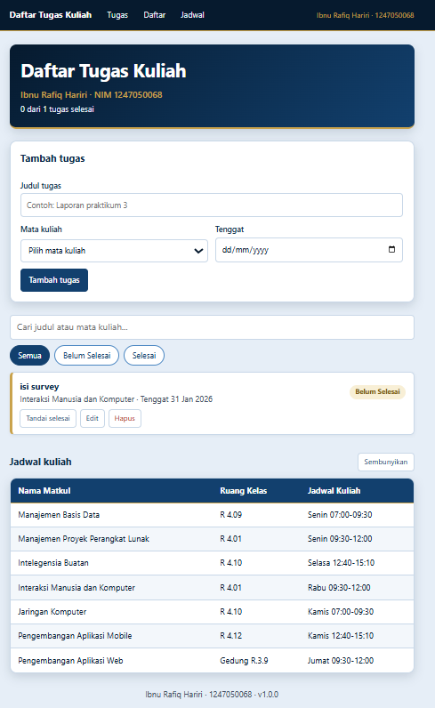

# Daftar Tugas Kuliah (React + Vite)

Aplikasi pencatat tugas kuliah yang dibuat dengan **React**, **TypeScript**, dan **Vite**.

- **Nama:** Ibnu Rafiq Hariri
- **NIM:** 1247050068

## Menjalankan proyek

```bash
npm install
npm run dev      # mode pengembangan
npm run build    # build produksi
```

## Screenshot

> Jalankan `npm run dev`, buka di browser, lalu simpan tangkapan layar ke folder `screenshots/` dengan nama di bawah ini.




## Komponen React

Semua komponen ada di `src/components/`, masing-masing di file terpisah (9 komponen + `App`).

| Komponen | Fungsi |
|---|---|
| `Navbar` | Navigasi tetap di atas (Tugas, Daftar, Jadwal) dan identitas mahasiswa |
| `Header` | Judul aplikasi, nama, NIM, dan ringkasan jumlah tugas selesai |
| `TaskForm` | Formulir tambah/edit tugas |
| `FilterBar` | Kolom pencarian dan tombol filter status |
| `TaskList` | Menampilkan daftar tugas atau pesan kosong |
| `TaskItem` | Satu baris tugas beserta tombol aksi |
| `ScheduleTable` | Tabel jadwal kuliah yang bisa disembunyikan/ditampilkan |
| `Footer` | Nama, NIM, dan versi aplikasi |
| `Button` *(reusable)* | Tombol dengan varian `default`/`primary`/`danger` dan ukuran `small` |
| `Badge` *(reusable)* | Label status tugas |

`App.tsx` adalah komponen induk yang menyimpan seluruh state dan handler.

## Konsep React yang digunakan

### Props
Data dikirim dari parent ke child. Contoh:
- `App` → `TaskList`: `tasks`, `totalCount`, `onToggle`, `onEdit`, `onDelete`
- `TaskList` → `TaskItem`: `task` dan ketiga handler
- `TaskItem` → `Badge`: `status`; `TaskItem` → `Button`: `variant`, `small`, `onClick`
- `App` → `Navbar`/`Header`/`Footer`: `nama`, `nim`, `appName`, `version`

Props berupa fungsi (`onToggle`, `onSubmit`, dst.) dipakai agar child bisa memberi tahu parent saat ada aksi.

### State (`useState`)
| State | Lokasi | Kegunaan |
|---|---|---|
| `tasks` | `App` | Daftar semua tugas (disimpan juga ke `localStorage`) |
| `editingId` | `App` | ID tugas yang sedang diedit (`null` jika tidak ada) |
| `filter` | `App` | Filter status aktif |
| `search` | `App` | Kata kunci pencarian |
| `values` | `TaskForm` | Isi input formulir (controlled input) |
| `visible` | `ScheduleTable` | Jadwal ditampilkan atau disembunyikan |

### Event handling
- `onSubmit` pada form → menambah atau menyimpan perubahan tugas
- `onChange` pada input/select/pencarian → memperbarui state
- `onClick` pada tombol → tandai selesai, edit, hapus, ganti filter, batal edit, show/hide jadwal

### Conditional rendering
- Judul & tombol form berubah antara "Tambah tugas" dan "Edit tugas"; tombol **Batal** hanya muncul saat mode edit
- `TaskList` menampilkan pesan kosong bila tidak ada tugas atau tidak ada yang cocok
- Tabel jadwal hanya dirender bila `visible` bernilai `true`

### List rendering
`map()` dengan `key` unik dipakai untuk daftar tugas (`key={task.id}`), tombol filter, opsi mata kuliah, tautan navigasi, dan baris jadwal.

## Fitur interaktif
1. Menambah tugas
2. Mengedit tugas
3. Menghapus tugas
4. Mengubah status (selesai / belum selesai)
5. Mencari tugas berdasarkan judul atau mata kuliah
6. Memfilter berdasarkan status
7. Menampilkan/menyembunyikan jadwal kuliah

## Struktur folder

```
src/
├── components/   # Komponen React
├── data/jadwal.ts
├── App.tsx
├── main.tsx
├── storage.ts    # generic helper localStorage
├── types.ts
└── style.css
```
